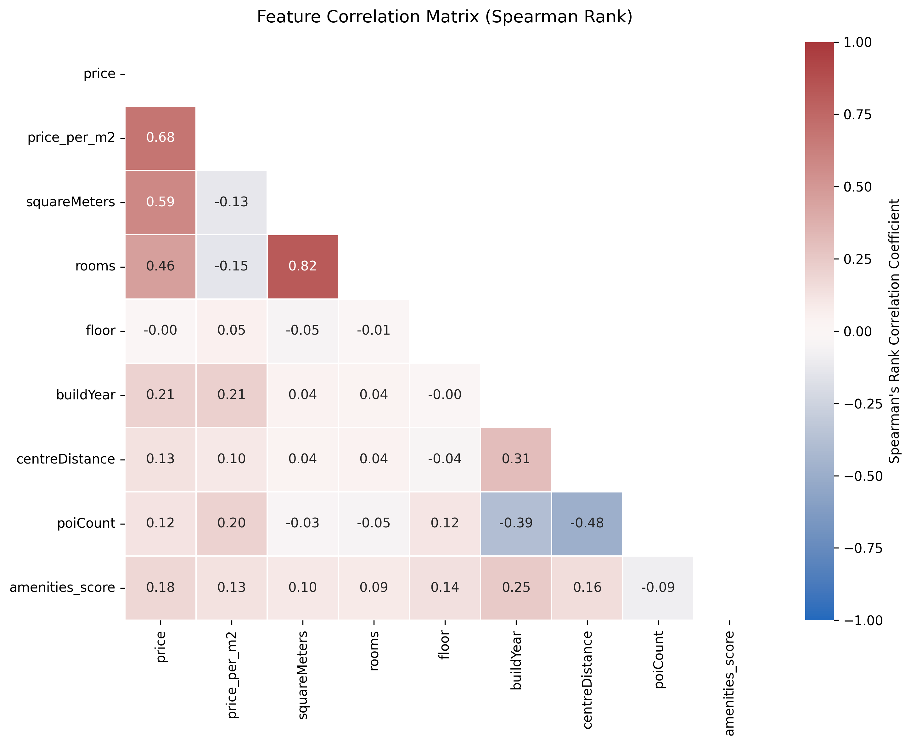
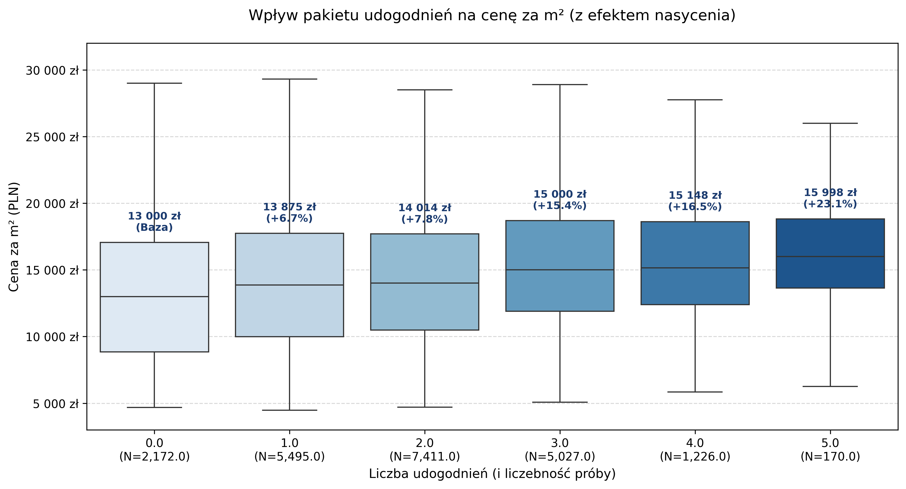
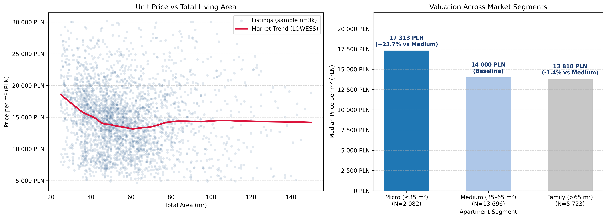
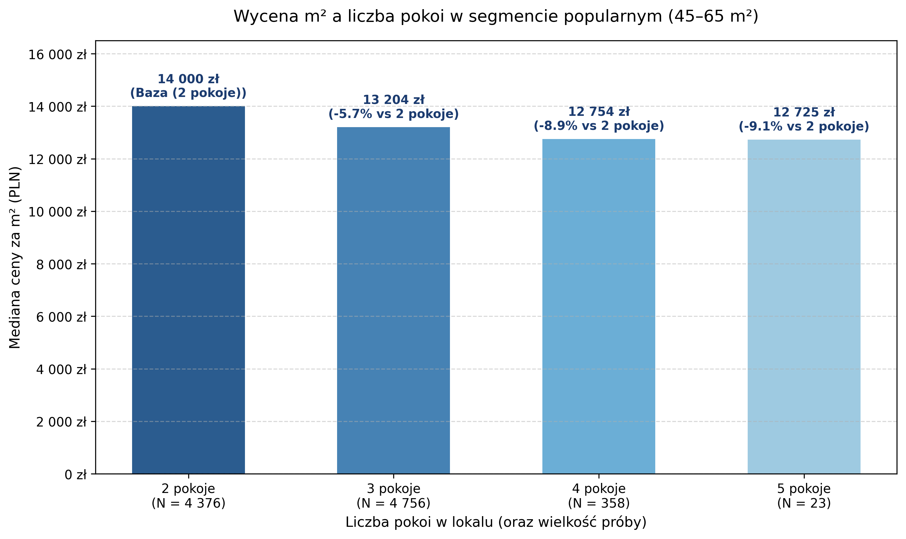
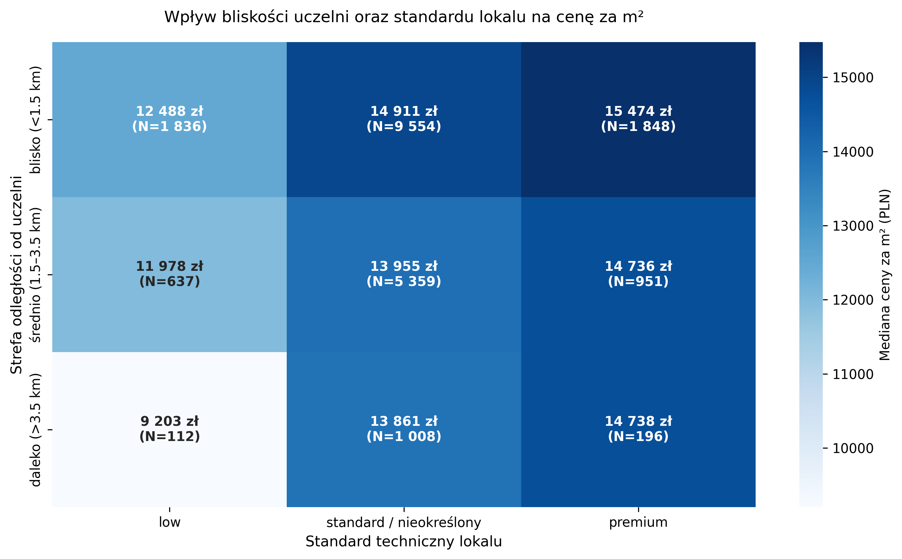

# 🏢 Polish Residential Real Estate Market Analysis (June 2024)
### Exploratory Data Analysis, Statistical Hypothesis Testing & Market Segmentation

[](https://colab.research.google.com/github/adamkubi456/polish-housing-market-eda/blob/main/polish_housing_eda.ipynb)


---

## 📌 Executive Summary

This project delivers an end-to-end data analysis of the Polish residential housing market across the **15 largest metropolitan areas** (including Warsaw, Kraków, Łódź, Wrocław, Poznań, and Gdańsk), based on listings aggregated in **June 2024**.

Beyond descriptive statistics, the study formulates and rigorously evaluates **four investment hypotheses** using non-parametric statistical methods (**Mann-Whitney U**, **Kruskal-Wallis**). The analysis uncovers economic mechanics: the **amenities saturation ceiling**, **micro-apartment valuation premiums**, **room density dynamics**, and **student hub resilience for distressed units** .

---

## 🔑 Key Insights & Business Findings

1. **Amenities Saturation Ceiling:** Adding basic conveniences (balcony, elevator, parking) increases unit valuation up to an **Amenities Score of 3 (+15.4% median premium)**. Accumulating further amenities yields diminishing returns, as premium properties hit an affordability ceiling.
2. **Micro-Apartment Premium (+23.7%):** Compact studios (≤ 35 m²) command a statistically significant unit premium over mass-market flats (35–65 m²), driven by lower nominal ticket size and high rental yields.
3. **Room Density Paradox:** Within the identical area envelope (45–65 m²), **2-room flats are valued 5.7% higher per m² than 3-room configurations**. Market preference prioritizes ergonomic living space over partitioned room count.
4. **Student Hub Protection for Distressed Assets:** Proximity to academic institutions acts as a valuation cushion: properties in low condition located < 1.5 km from universities retain a **+35.7% unit price premium** compared to distant counterparts.

---

## 🗺️ Geospatial Exploration

Interactive spatial mapping of **Warsaw** in Plotly highlights clear valuation clusters and price decay radiating from the capital center along rapid transit arteries.

* 🌐 **[Launch via GitHub Pages](https://adamkubi456.github.io/polish-housing-market-eda/assets/warsaw_price_map.html)**

---

## 📈 Correlation Analysis

The feature correlation matrix (Spearman Rank) details the relationships across continuous and ordinal attributes:



---

## 📊 Hypothesis Deep Dives

### 🧪 Hypothesis 1: Amenities Bundle Premium & Saturation Effect
> **Hypothesis:** Accumulating additional conveniences increases unit valuation, with diminishing returns beyond a standard package.  
> **Result: Confirmed (Saturation at Score 3).**  
> **Omnibus Test: Kruskal-Wallis H** = 386.58, p = 2.32e-81 (α = 0.01) — confirms significant valuation differences across amenity tiers.  
> **Mann-Whitney U** (Score 3 vs 4) = 3.15e+06, p = 0.1073 (one-sided) — confirms no statistically significant price premium between 3 and 4 amenities (p >= 0.01), empirically validating the market saturation ceiling.

Valuation increases rapidly as properties move from 0 amenities (baseline) to 3 amenities (+15.4% median premium). Properties with 4 and 5 amenities plateau around 15,100–16,000 PLN/m², showing diminishing marginal returns for additional standard features.



---

### 🧪 Hypothesis 2: Micro-Apartment Valuation Premium
> **Hypothesis:** Small apartments (≤ 35 m²) trade at a significantly higher price per m² than medium-sized units (35–65 m²).  
> **Result: Confirmed.**  
> *Test:* Mann-Whitney U = 1.86e+07, p = 6.38e-112 (α = 0.01, one-sided).

Micro-apartments trade at a median of **17,313 PLN/m² (+23.7% premium)** compared to medium units (14,000 PLN/m²).


---

### 🧪 Hypothesis 3: Room Density vs. Unit Valuation (45–65 m²)
> **Hypothesis:** Dividing a mid-sized apartment into 3 rooms creates higher unit value than a standard 2-room layout.  
> **Result: Rejected (Significant Reverse Effect).**  
> *Test:* Mann-Whitney U = 9.24e+06, p = 1.00 (one-sided for 3 rooms > 2 rooms, α = 0.01); reverse relationship confirmed (2 rooms > 3 rooms, p < 0.001).

Controlling for total area (45–65 m²), **2-room layouts achieve a median price of 14,000 PLN/m²**, whereas 3-room configurations achieve **13,204 PLN/m² (-5.7%)**. Buyers penalize overly fragmented layouts in favor of open-plan living areas.



---

### 🧪 Hypothesis 4: Student Hub Resilience for Distressed Units
> **Hypothesis:** Close proximity to universities protects the valuation of apartments requiring renovation (`condition = low`).  
> **Result: Confirmed.**  
> *Test:* Mann-Whitney U = 1.28e+05, p = 3.28e-06 (α = 0.01, one-sided).

Properties in low condition located < 1.5 km from university campuses command **12,488 PLN/m²** vs. **9,204 PLN/m²** for those > 3.5 km away (**+35.7% price cushion**). Rental demand around academic hubs shields distressed assets from standard market penalties.



---

## 📑 Summary of Statistical Inference

| # | Hypothesis | Statistical Test | Test Statistic | p-value | Significance (α = 0.01) | Empirical Verdict |
|---|---|---|---|---|---|---|
| **H1a** | Amenities score overall effect (0–5) | Kruskal-Wallis H | 386.58 | 2.32e-81 | **Yes** | **Confirmed** (Significant variation across scores) |
| **H1b** | Amenities saturation ceiling (Score 4 vs 3) | Mann-Whitney U (one-sided) | 3.15e+06 | 0.1073 | **No** (p ≥ 0.01) | **Confirmed** (No premium for 4th amenity; plateau reached) |
| **H2** | Micro-unit valuation premium (≤ 35 m²) | Mann-Whitney U (one-sided) | 1.86e+07 | 6.38e-112 | **Yes** | **Confirmed** (+23.7% unit price premium) |
| **H3** | Higher valuation for 3 vs 2 rooms (45–65 m²) | Mann-Whitney U (one-sided) | 9.24e+06 | 1.00 | **No** | **Rejected** (2-room units lead by 5.7%) |
| **H4** | University proximity shields low-condition units | Mann-Whitney U (one-sided) | 1.28e+05 | 3.28e-06 | **Yes** | **Confirmed** (+35.7% price cushion) |

---

## ⚠️ Project Limitations & Domain Assumptions

1. **Asking Prices vs. Transaction Prices:**  
   The dataset consists exclusively of web-scraped asking (listing) prices. In the Polish real estate market, actual transaction prices historically deviate downward by 5% to 15% due to negotiation margins and mortgage qualification timelines.
2. **Condition Variable Missingness:**  
   The `condition` feature exhibits an ~75% missing data rate. In Polish classifieds, condition is selectively reported for premium/renovated units or heavily distressed properties, leaving standard-tier listings unlabeled.
3. **Temporal Dynamics (June 2024):**  
   The dataset covers a 1-month observation window.

---

## 📂 Data Source & Attribution

The analysis is based on real estate listings scraped from major Polish property portals:
* **Dataset:** [Apartment Prices in Poland (Kaggle)](https://www.kaggle.com/datasets/krzysztofjamroz/apartment-prices-in-poland)
* **Author:** Krzysztof Jamróz
* **Temporal Coverage:** Monthly scrapes between **June 2024**
* **Geographical Scope:** 15 largest cities in Poland (Warszawa, Kraków, Łódź, Wrocław, Poznań, Gdańsk, Szczecin, Bydgoszcz, Lublin, Katowice, Białystok, Częstochowa, Radom, Sosnowiec, Toruń)

---

## 💻 Tech Stack & Methods

* **Language:** Python 3.10+
* **Data Manipulation:** `pandas`, `numpy`
* **Statistical Inference:** `scipy.stats` (Mann-Whitney U, Kruskal-Wallis H)
* **Visualization:** `matplotlib`, `seaborn`, `statsmodels` (LOWESS trend)
* **Interactive Mapping:** `plotly.express` (Mapbox with Esri raster layers)

---

## 🚀 How to Reproduce

1. **Clone the repository:**
   ```bash
   git clone https://github.com/adamkubi456/polish-housing-market-eda.git
   cd polish-housing-market-eda
   ```

2. **Obtain the dataset:**
   * Download the dataset from [Kaggle](https://www.kaggle.com/datasets/krzysztofjamroz/apartment-prices-in-poland).
   * Place the data file in your project working directory.

3. **Install dependencies:**
   ```bash
   pip install -r requirements.txt
   ```

4. **Run analysis:**  
   Open and execute `polish_housing_eda.ipynb` in Jupyter Notebook or Google Colab.

---

## 👤 Author

* **Adam Kubiak**
* LinkedIn: [Adam Kubiak](https://www.linkedin.com/in/adam-kubiak-a91a66443/)
* GitHub: [@adamkubi456](https://github.com/adamkubi456)
* Email: akubiakds@wp.pl
